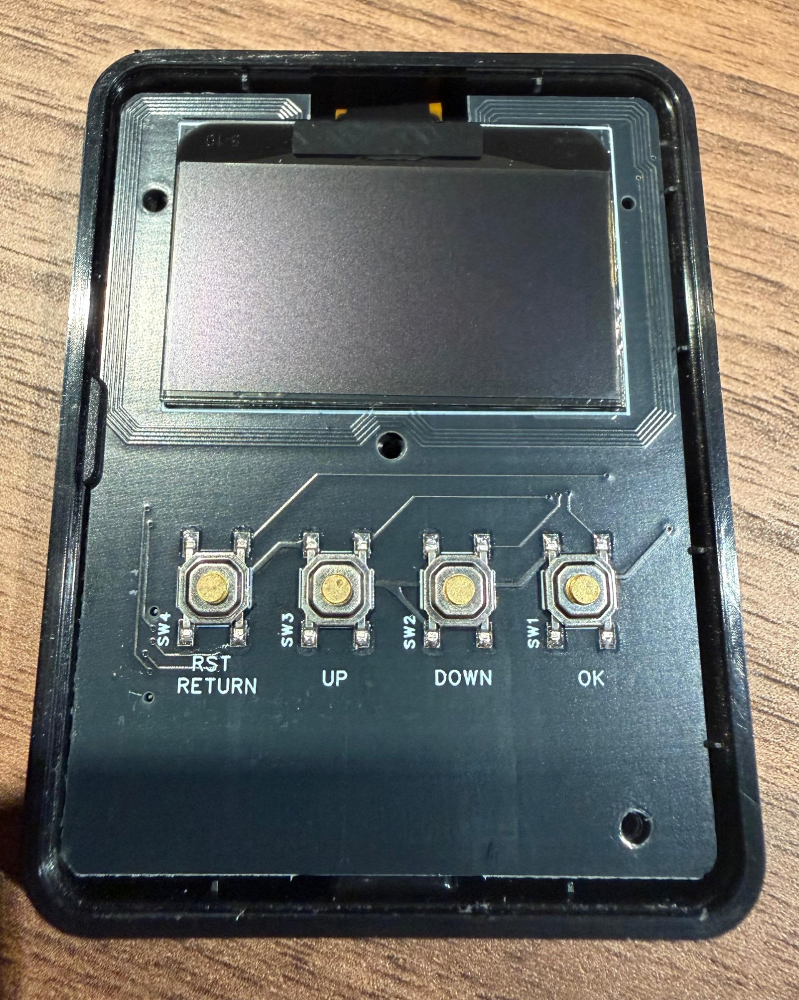
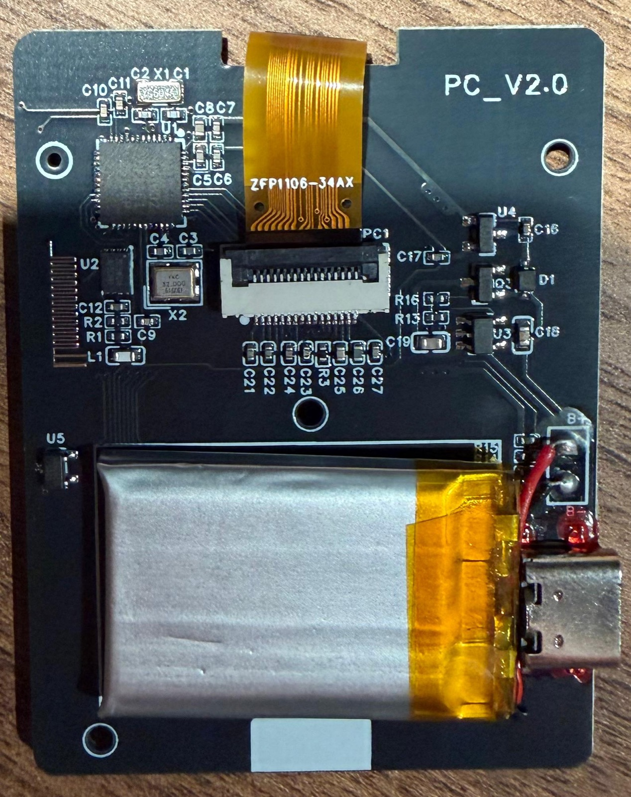

# OLED 4-Button Version (PC_V2.0)

A bigger OLED board with a fourth "back" button, silkscreened **PC_V2.0**. It is a re-layout of the OLED board by @xiaohail ([gitlab.com/xiaohai/pixl.js](https://gitlab.com/xiaohai/pixl.js)). Build it with `BOARD=OLED_4BTN`.

No design files exist for PC_V2.0. Everything here comes from photos, chip markings, multimeter measurements, firmware testing, and xiaohai's KiCad netlist, which the circuit closely follows. The reference designators are the ones printed on the PC_V2.0 board, and they differ from xiaohai's.

| Front | Back |
| --- | --- |
|  |  |

## How sure are we

Each entry is one of:

- **Verified**: a chip marking was read, it was measured on the board, or it works with the `OLED_4BTN` firmware.
- **Inferred**: it matches xiaohai's netlist and the part placement, but nobody has tested it on PC_V2.0.
- **Unknown**: not found yet.

## Differences from xiaohai's OLED board

| | xiaohai OLED | PC_V2.0 |
| --- | --- | --- |
| Input | 3-way thumbwheel (left / push / right) | 4 buttons: UP, DOWN, OK, RETURN |
| Back button | none | SW4 on **P0.20** (a free GPIO on xiaohai's board) |
| Display mounting | normal | rotated 180° (`OLED_ROTATION_180`) |
| NFC antenna | 0.2 mm enameled wire, 5.5 turns around a screw post | copper loop on the PCB around the display |
| Power path | CJL2623 dual MOSFET (power path + Hall reset) | AO3401A P-MOSFET (Q3) + Schottky diode (D1) |
| Hall sensor | MH254ESQ, resets the MCU through a MOSFET | CC6201ST (U5), resets the MCU when a magnet is near |
| Battery | 501525 | 402030, 3.7 V 200 mAh |
| LEDs | status LED + charge LED | none |
| SWD access | 4 pads (J2), also wired to USB-C D+/D− | no pads; SWDCLK and SWDIO are on the USB-C data pins. Ships with a bootloader and is updated over OTA |
| Screen | 1.3" / 1.54" OLED or LCD footprints | 1.3" SH1106 OLED only |

## nRF52832 pin map

U1 is an nRF52832-QFAA in a QFN-48 package, marked `N52832 QFAAE1` (verified). Pin 1 is the corner with the dot.

| Pin | Signal | Connects to | Status |
| --- | --- | --- | --- |
| 1 | DEC1 | decoupling cap | Inferred |
| 2 | P0.00 / XL1 | X1 32.768 kHz crystal + load cap | Inferred |
| 3 | P0.01 / XL2 | X1 32.768 kHz crystal + load cap | Inferred |
| 4 | P0.02 / AIN0 | battery voltage divider (`ADC_PIN`) | Inferred |
| 5 | P0.03 / AIN1 | charger U3 CHRG# output (`CHRG_PIN`) | Inferred |
| 7 | P0.05 | **SW2 DOWN** | Verified |
| 8 | P0.06 | **SW1 OK** | Verified |
| 9 | P0.07 | **SW3 UP** | Verified |
| 11 | NFC1 / P0.09 | NFC antenna loop, C10 / C11 to GND | Verified |
| 12 | NFC2 / P0.10 | NFC antenna loop, C10 / C11 to GND | Verified |
| 13, 36, 48 | VDD | +3V3 | Inferred |
| 21 | P0.18 | U2 flash CS# | Verified |
| 22 | P0.19 | U2 flash SO (MISO) | Verified |
| 23 | P0.20 | **SW4 RETURN (back)** | Verified |
| 24 | P0.21 / nRESET | U5 Hall sensor output. A magnet resets the chip or wakes it from sleep | Verified |
| 25 | SWDCLK | USB-C connector pins 6 and 8 | Verified |
| 26 | SWDIO | USB-C connector pins 5 and 7 | Verified |
| 30 | ANT | L1 / C9 matching network, then the PCB meander antenna | Inferred |
| 31, 45, EP | VSS | GND | Inferred |
| 32 | DEC2 | decoupling cap | Inferred |
| 33 | DEC3 | decoupling cap | Inferred |
| 34 | XC1 | X2 32 MHz crystal + load cap | Inferred |
| 35 | XC2 | X2 32 MHz crystal + load cap | Inferred |
| 37 | P0.25 | SPI MOSI: OLED D1 (SDIN) and flash SI | Verified |
| 38 | P0.26 | SPI SCK: OLED D0 (SCLK) and flash SCLK | Verified |
| 39 | P0.27 | OLED CS# | Verified |
| 40 | P0.28 | OLED D/C# | Verified |
| 41 | P0.29 | OLED RES# | Verified |
| 42 | P0.30 | backlight on the LCD build, unused on OLED | Unknown |
| 43 | P0.31 | status LED in the firmware; PC_V2.0 has no LED | Verified |
| 46 | DEC4 | decoupling cap | Inferred |
| 47 | DCC | not connected (LDO mode, no DC/DC inductor) | Inferred |

The other GPIOs are unused. The four buttons pull their GPIO to GND when pressed and use the nRF52832's internal pull-ups (`NRF_GPIO_PIN_PULLUP`), so there are no external resistors on them.

SW4 is printed "RST / RETURN", but it is a normal GPIO button on P0.20. It does not reset the chip.

### Key mapping in the firmware

| Physical | Silkscreen | GPIO | `input_key_t` |
| --- | --- | --- | --- |
| far right | SW1 OK | P0.06 | `INPUT_KEY_CENTER` |
| middle right | SW2 DOWN | P0.05 | `INPUT_KEY_RIGHT` |
| middle left | SW3 UP | P0.07 | `INPUT_KEY_LEFT` |
| far left | SW4 RST/RETURN | P0.20 | `INPUT_KEY_BACK` |

## Power

```
VBUS ─┬─► U3 VCC        U3 BAT ─┬─► B+ ── LiPo 402030
      │                         ├─► R14 ─┬─► P0.02 (ADC)
      │                         │        └─► R15 ─► GND
      │                         │
      │                         └─► Q3 drain
      ├─► Q3 gate                   Q3 source ─┐
      ├─► R16 ─► GND                           ├─► VSYS ─► U4 VIN ─► +3V3
      └─► D1 anode       D1 cathode ───────────┘

USB-C CC1 / CC2 ─► R17 / R18 ─► GND
U3 PROG ─► R13 ─► GND
```

This is a standard load-sharing power path, and the voltages below confirm it:

- **On USB:** VBUS (5.26 V) keeps Q3's gate high, so Q3 is off. The board runs from USB through D1 (VSYS is 4.99 V, a 0.28 V Schottky drop) and the charger only charges the battery.
- **On battery:** R16 pulls Q3's gate to GND, Q3 turns on, and the battery feeds the LDO.

Measured on USB power with the battery disconnected, against B−:

| Net | Voltage | Points |
| --- | --- | --- |
| VBUS | 5.26 V | D1 anode, Q3 gate, U3 VCC, R16 |
| VSYS (LDO input) | 4.99 V | D1 cathode, Q3 source, U4 VIN |
| BAT | 4.25–4.38 V (no battery, so the charger output drifts) | U3 BAT, Q3 drain, R14 |
| +3V3 | 3.34 V | U4 VOUT |
| Battery divider | 2.90 V | R14 / R15 junction |
| PROG | about 0.05 V (not charging) | U3 PROG, R13 |
| CC (cable side in use) | 1.64 V | R18 |

The 2.90 V divider reading fits xiaohai's 806 kΩ / 2 MΩ divider once the meter's 10 MΩ input is counted, so R14 / R15 are probably those values (inferred).

### U3: Li-ion charger, SOT-23-5, marking `55b2`

Probably a TP4055, like xiaohai's (inferred). The measured pins match the TP4054 / TP4055 pinout:

| Pin | Name | Net | Measured |
| --- | --- | --- | --- |
| 1 | CHRG# | P0.03 (open drain, low while charging) | 3.3 V (not charging) |
| 2 | GND | GND | 0 V |
| 3 | BAT | B+ | 4.25–4.38 V |
| 4 | VCC | VBUS | 5.26 V |
| 5 | PROG | R13 to GND; sets the charge current (I = 1000 V / R<sub>PROG</sub>) | 0.05 V |

### Q3: power-path P-MOSFET, SOT-23, marking `A19T`

AO3401A. Gate on VBUS, source on VSYS, drain on BAT (measured).

### D1: Schottky diode, marking `S4`

Anode on VBUS, cathode on VSYS (measured). Probably a 1N5819W (inferred).

### U4: 3.3 V LDO, SOT-23, marking `662K`

XC6206P332MR. The pinout is confirmed by measurement.

| Pin | Name | Net | Measured |
| --- | --- | --- | --- |
| 1 | VSS | GND | 0 V |
| 2 | VOUT | +3V3 | 3.34 V |
| 3 | VIN | VSYS | 4.98 V |

### U5: Hall sensor, SOT-23, marking `6201`

CrossChip CC6201ST, a micropower omnipolar Hall switch (it reacts to either pole). It resets the board like the Hall sensor on xiaohai's:

- Device on: hold a magnet against the back, over U5. The screen goes off and comes back about a second later because the chip resets.
- Device asleep: a magnet wakes it up.

There is no second MOSFET here, so U5's output probably drives nRESET directly (inferred).

## Display (PC1)

A 1.3" 128×64 OLED with an SH1106 driver, on an FPC marked `ZFP1106-34AX`, driven over 4-wire SPI.

PC1 is not xiaohai's connector. On xiaohai's board the panel's 30-pin tail is soldered to the PCB. On PC_V2.0 the panel has a shorter tail that plugs into a **16-pin ZIF connector** with 0.5 mm pitch (8 mm across the 16 contacts). On the panel's ribbon, 15 traces reach the contacts and 3 more stop early at vias.

Legs are numbered 1–16 from the left, looking at the back of the board with `PC_V2.0` at the top right. Voltage on each leg with USB power and the display on, against B−:

| Leg | 1 | 2 | 3 | 4 | 5 | 6 | 7 | 8 | 9 | 10 | 11 | 12 | 13 | 14 | 15 | 16 |
| --- | --- | --- | --- | --- | --- | --- | --- | --- | --- | --- | --- | --- | --- | --- | --- | --- |
| V | 0.2 | 3.4 | 7.98 | 3.12 | 3.34 | 0 | 3.34 | 3.34 | 3.34 | 3.34 | 0 | 0 | 5.6 | 8.0 | 8.03 | 0 |

Continuity tests (USB unplugged, B+ unsoldered) against B−, +3V3, the U2 pads, R3 and C21–C27 give this pinout:

| Leg | Function | How it was found | Status |
| --- | --- | --- | --- |
| 1, 2 | C1P / C1N, charge-pump flying cap | C21 sits between legs 1 and 2 | Verified cap, which pump cap is inferred |
| 3, 4 | C2P / C2N, charge-pump flying cap | C22 sits between legs 3 and 4 | Verified cap, which pump cap is inferred |
| 5, 7 | VDD / VBAT (+3V3) | beep to +3V3 and U2 VCC; C23, C24 to GND | Verified |
| 6, 16 | GND | beep to B− and U2 GND | Verified |
| 8, 9, 10 | CS#, D/C#, RES# in unknown order | idle at 3.34 V, not tied to +3V3 or U2 | Unknown order |
| 11 | SCK (D0) | beeps to U2 SCLK, idle 0 V | Verified net, inferred pad numbering |
| 12 | MOSI (D1 / SDIN) | beeps to U2 SI, idle 0 V | Verified net, inferred pad numbering |
| 13 | IREF | R3 (558 kΩ) to GND, 5.6 V | Verified |
| 14, 15 | VCC (charge-pump output, about 8 V) | C25 on leg 14, C26 and C27 on leg 15, all to GND | Verified caps, VCC inferred |

No leg goes to a separate VCOMH capacitor, so VCOMH is probably not brought out on this tail (inferred).

For comparison, this is xiaohai's 30-pin layout (connector J3):

| Pin | SH1106 function | Net (xiaohai) |
| --- | --- | --- |
| 1 | NC / GND | GND |
| 2, 3 | C2P, C2N | 1 µF charge-pump cap between pins 2 and 3 |
| 4, 5 | C1P, C1N | 1 µF charge-pump cap between pins 4 and 5 |
| 6 | VBAT (charge-pump supply) | +3V3 |
| 7 | NC | none |
| 8 | VSS | GND |
| 9 | VDD | +3V3 |
| 10, 11, 12 | BS0, BS1, BS2 | GND (pins 10–11 through 4.7 kΩ / 0 Ω), selects 4-wire SPI |
| 13 | CS# | P0.27 |
| 14 | RES# | P0.29 |
| 15 | D/C# | P0.28 |
| 16, 17 | R/W#, E/RD# | GND |
| 18 | D0 (SCLK) | P0.26 |
| 19 | D1 (SDIN) | P0.25 |
| 20 | D2 | NC |
| 21–25 | D3–D7 | GND |
| 26 | IREF | 560 kΩ to GND |
| 27 | VCOMH | 2.2 µF to GND |
| 28 | VCC (charge-pump output) | 2.2 µF + 1 µF to GND |
| 29, 30 | VLSS, NC | GND |

## USB-C connector

A 12-pin footprint, power only. Pins are counted 1–12 along the footprint from the back. The table shows resistance to GND (pin 1) with the board unpowered, in Ω mode:

| Pin | To GND | Meaning | Status |
| --- | --- | --- | --- |
| 1, 12 | 0 Ω | GND | Verified |
| 2, 11 | about 98 kΩ | VBUS | Inferred |
| 3, 9 | about 4.9 kΩ | CC1 / CC2 (5.1 kΩ pull-downs R17, R18) | Verified |
| 4, 10 | open | SBU1 / SBU2, not connected | Inferred |
| 5, 7 | 7.7–9.3 MΩ | MCU pin 26 (SWDIO) | Verified net, D+ or D− unknown |
| 6, 8 | 9–10 MΩ | MCU pin 25 (SWDCLK) | Verified net, D+ or D− unknown |

The two data signals alternate along the footprint (5 and 7 are one, 6 and 8 the other). As on xiaohai's board, SWDIO and SWDCLK are on them, so the USB-C port can be used for debugging. We don't know if the chip's debug protection (APPROTECT) is on.

## SPI flash (U2)

U2 is a Zbit ZD25WQ16, a 16 Mbit SPI NOR flash in USON-8 (3 × 2 mm). It is fitted and required, because the firmware stores its files on it (SPIFFS).

| Pin | Name | Net | Status |
| --- | --- | --- | --- |
| 1 | CS# | P0.18 | Verified |
| 2 | SO | P0.19 | Verified |
| 3 | WP# | pull-up R1 to +3V3 | Verified |
| 4 | GND | GND | Verified |
| 5 | SI | P0.25, and PC1 leg 12 | Verified |
| 6 | SCLK | P0.26, and PC1 leg 11 | Verified |
| 7 | HOLD# | pull-up R2 to +3V3 | Verified |
| 8 | VCC | +3V3, decoupled by C12 | Inferred |

Pad numbering on the board: the top row, left to right, is pins 4, 3, 2, 1 and the bottom row, left to right, is pins 5, 6, 7, 8. This is the standard USON-8 order and it fits the measurements (top left is GND, bottom right is VCC, and the pull-ups are on pins 3 and 7).

## Bill of Materials

Values come from xiaohai's design where the role is the same. The ceramic capacitors have no markings, so their values can't be read from photos. Parts hidden under the battery are not listed.

| Designator | Description | Package | Part | Status |
| --- | --- | --- | --- | --- |
| U1 | BLE + NFC-A SoC, 512 KB flash / 64 KB RAM | QFN-48 6×6 mm | Nordic nRF52832-QFAA | Verified |
| U2 | 16 Mbit SPI NOR flash | USON-8 3×2 mm | Zbit ZD25WQ16 (alt. GD25Q16) | Verified |
| U3 | Li-ion linear charger | SOT-23-5 | TP4055 (marking `55b2`) | Inferred |
| U4 | 3.3 V LDO | SOT-23 | Torex XC6206P332MR (marking `662K`) | Verified |
| U5 | Omnipolar Hall switch, magnet reset | SOT-23 | CrossChip CC6201ST (marking `6201`) | Verified |
| Q3 | P-channel MOSFET, power path | SOT-23 | AO3401A (marking `A19T`) | Verified |
| D1 | Schottky diode, power path | SOD-123 | 1N5819W / B5819W (marking `S4`) | Inferred |
| X1 | 32.768 kHz crystal | SMD 3.2×1.5 mm | marking `YG604A` | Inferred |
| X2 | 32 MHz crystal | SMD 4-pad | YXC 32.000 MHz | Verified |
| C1, C2 | X1 load caps | 0402 | 12 pF C0G | Inferred |
| C3, C4 | X2 load caps | 0402 | 12 pF C0G | Inferred |
| C5–C8 | MCU DEC / VDD decoupling | 0402 | 100 nF, 1 µF, 4.7 µF (exact mapping unknown) | Unknown |
| C10, C11 | NFC tuning caps, NFC pin to GND | 0402 | value unknown | Role verified |
| L1, C9 | 2.4 GHz antenna matching | 0603 / 0402 | 3.9 nH + 0.8 pF | Inferred |
| C12 | flash decoupling | 0402 | 100 nF | Inferred |
| R1 | flash WP# pull-up | 0402 | 4.98 kΩ measured in circuit (about 5 kΩ) | Role verified |
| R2 | flash HOLD# pull-up | 0402 | 2.49 kΩ measured in circuit | Role verified |
| R3 | OLED IREF | 0402 | 558 kΩ measured in circuit (about 560 kΩ) | Verified |
| C21, C22 | OLED charge-pump flying caps (legs 1–2, 3–4) | 0402 / 0603 | 1 µF | Role verified, value inferred |
| C23, C24 | OLED VDD / VBAT decoupling | 0402 / 0603 | 1 µF | Role verified, value inferred |
| C25–C27 | OLED VCC decoupling (legs 14 / 15 to GND) | 0402 / 0603 | 2.2 µF, 1 µF | Role verified, value inferred |
| C16–C19 | power capacitors (charger, LDO in / out) | 0402 / 0603 / 0805 | 1–10 µF | Inferred |
| R13 | charger PROG (sets the charge current) | 0402 | 16.3 kΩ measured in circuit (about 16 kΩ), roughly 61 mA if U3 is a TP4055 (xiaohai: 5 kΩ, 200 mA) | Role verified, current inferred |
| R14, R15 | battery voltage divider to P0.02 | 0402 | 806 kΩ (top), 2 MΩ (bottom) | Role verified, values inferred |
| R16 | Q3 gate pull-down | 0402 | measures 98 kΩ one way and 76 kΩ with the probes swapped; most likely 100 kΩ | Role verified, value inferred |
| R17, R18 | USB-C CC1 / CC2 pull-downs | 0402 | 5.1 kΩ | Role verified, value inferred |
| SW1–SW4 | tactile switch, 4-pad SMD | about 5.2×5.2 mm | generic | Verified |
| PC1 | 16-pin FPC/ZIF connector for the OLED | SMD, 0.5 mm pitch | generic | Verified |
| — | USB-C receptacle (power only) | SMD, 12-pin | generic | Verified |
| — | 1.3" 128×64 OLED, SH1106, 30-pin FPC `ZFP1106-34AX` | — | generic | Verified |
| BT | LiPo cell with protection board | 402030 | 3.7 V 200 mAh | Verified |
| — | NFC antenna | PCB copper loop | — | Verified |

## Still to do

### Which PC1 leg is CS#, D/C# and RES#

SCK (leg 11) and MOSI (leg 12) are known. Legs 8, 9 and 10 are CS#, D/C# and RES# in some order, and only a logic analyzer can tell them apart. The contacts are too small to clip onto directly, so plug a 16-pin 0.5 mm FFC cable into PC1 (with the panel unplugged) and clip onto a breakout board on the other end.

1. Connect the analyzer's ground to the B− pad.
2. Put channels on legs 8, 9 and 10, plus legs 11 and 12 as a check. Keep away from legs 1–4 and 13–15, which carry up to 8 V when the panel is connected.
3. Start the capture, plug in USB so the device boots, and press a few buttons.

What each signal looks like:

| Signal | Pattern |
| --- | --- |
| RES# | one low pulse at boot, then high |
| CS# | low during each burst of data, high in between |
| SCK | clock bursts while CS# is low |
| MOSI | changing data while SCK runs |
| D/C# | low during command bytes (mostly at boot), high during screen data |

With the SPI decoder on SCK / MOSI / CS#, the first bytes after the RES# pulse should be the display init sequence, starting with `0xAE` (display off).

### Other

- Which USB-C data pair (5 / 7 or 6 / 8) is D+ and which is D−. This needs the connector's datasheet.
- The values of C10 and C11.

## License

This documentation is derived from xiaohai's OLED hardware and uses the same license, **GPL-2.0-or-later**. xiaohai's README also asks that the design not be used commercially.
